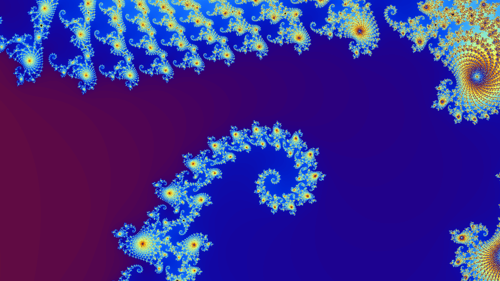

# mandelbrot-neon

[](https://github.com/sushanth-dev/mandelbrot-neon/actions/workflows/ci.yml)

A Mandelbrot renderer in Rust with a hand-vectorized NEON inner loop (two `f64` pixels per instruction) next to a scalar loop, so the speedup is measured and not assumed. Standard library only, no dependencies. aarch64 only.



## Run it

```
cargo run --release -- render --cx -0.74364389 --cy 0.1318259 --zoom 400 --iter 3000 --out seahorse.ppm
cargo run --release -- bench
cargo test --release
```

Flags: `--cx --cy --zoom --width --height --iter --threads --scalar --out`. Output is a PPM file (`sips -s format png in.ppm --out out.png` converts it on macOS).

## Results

Apple M1 Pro, 8 threads, 1920x1080, `max_iter` 1000, default view. Median of 5 runs after one warm-up run:

| Config | Seconds | Giter/s | Speedup |
|---|---|---|---|
| scalar, 1 thread | 2.248 | 0.281 | 1.00x |
| neon, 1 thread | 1.096 | 0.576 | 2.05x |
| scalar, 8 threads | 0.352 | 1.791 | 6.38x |
| neon, 8 threads | 0.180 | 3.497 | 12.46x |

`bench` asserts that all four outputs are identical pixel for pixel, so the speedup is not bought with different maths. The unit tests check the same on odd widths (which exercise the scalar tail) and on a boundary-heavy deep view.

These numbers are from one machine that was not idle (load average about 4.6 during the runs). Two earlier runs of the same benchmark gave 11.92x and 10.48x for NEON on 8 threads, so expect roughly 10x to 12.5x.

## Thread scaling

NEON, full HD image, `max_iter` 1000, best of 3 runs per thread count, same busy machine:

| Threads | Seconds | Speedup over 1 thread |
|---|---|---|
| 1 | 1.094 | 1.00x |
| 2 | 0.552 | 1.98x |
| 4 | 0.282 | 3.88x |
| 6 | 0.192 | 5.70x |
| 7 | 0.174 | 6.29x |
| 8 | 0.163 | 6.71x |
| 10 | 0.164 | 6.67x |
| 12 | 0.163 | 6.71x |

Scaling is near linear up to 6 threads (95% efficiency) and flat after 8. The M1 Pro has 6 performance and 2 efficiency cores, and threads 7 and 8 add only about 1.0x together, so an efficiency core does roughly half the work of a performance core. That fits the 8-thread ceiling of about 7x, and 6.71x is 96% of the 6 + 2 x 0.5 = 7.0 that this predicts. This is a fit to the same data, not an independent measurement; I tried to time one thread on an efficiency core with `taskpolicy -b`, but that also lowers the clock (3.4x slower) so I did not use it. Row hand-out through the shared iterator is not the bottleneck: it would have shown up as sub-linear scaling below 6 threads.

## How it works

- Each pixel iterates `z = z^2 + c` until `|z|^2 >= 4` or `max_iter`.
- The NEON loop keeps a sticky active mask per lane. A lane that escapes stops counting while its neighbour keeps going, and the loop exits when both lanes are done.
- Both loops use separate multiply and add, never fused multiply-add. That keeps rounding identical, which is why the iteration counts match exactly.
- Threads take one row at a time from a shared iterator. Rows near the set cost far more than rows far from it, so fixed bands would leave threads idle.
- Multi-threaded speedup stops at about 6.7x on 8 cores. The data fits two slower efficiency cores (see Thread scaling), but I did not isolate that as the cause.

## Limits

- `f64` precision limits how deep it can zoom. Pixels collapse into blocks past a point I have not measured.
- `--cx`, `--cy` and `--zoom` must be finite; `nan` and `inf` are rejected.
- Colouring uses raw iteration counts, so bands are visible in some views.
- The only `unsafe` is the NEON intrinsics block in `neon_row`. NEON is part of the aarch64 baseline.
- Non-aarch64 targets fail to compile on purpose (`compile_error!`).

## License

MIT
